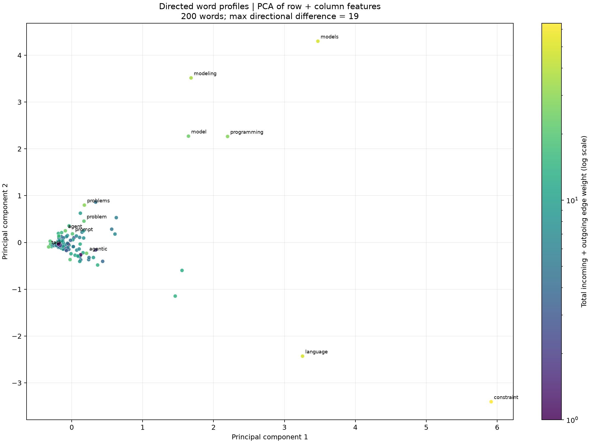

# adjacency_embedding_viz.py

## 功能

将有向矩阵中每个词的出边和入边特征拼接后用 PCA 降至二维，输出坐标和散点图。

## 输入与输出

输入为带标签的有向加权方阵 CSV；输出为 PCA 坐标 CSV 和散点图。

## 输出示例

下图使用 `1.md` 生成的有向共现矩阵，将词的出边和入边特征降到二维。



## 参数

以下为脚本当前提供的完整命令行参数和默认值。

```text
usage: adjacency_embedding_viz.py [-h] [--outdir OUTDIR]
                                  [--label-top LABEL_TOP]
                                  input

Project directed word profiles (outgoing + incoming) to two dimensions.

positional arguments:
  input                 Directed weighted square matrix CSV

options:
  -h, --help            show this help message and exit
  --outdir OUTDIR
  --label-top LABEL_TOP
                        Number of highest-total-weight words to label
                        (default: 15)
```

参数变更以脚本的 `--help` 输出为准。
