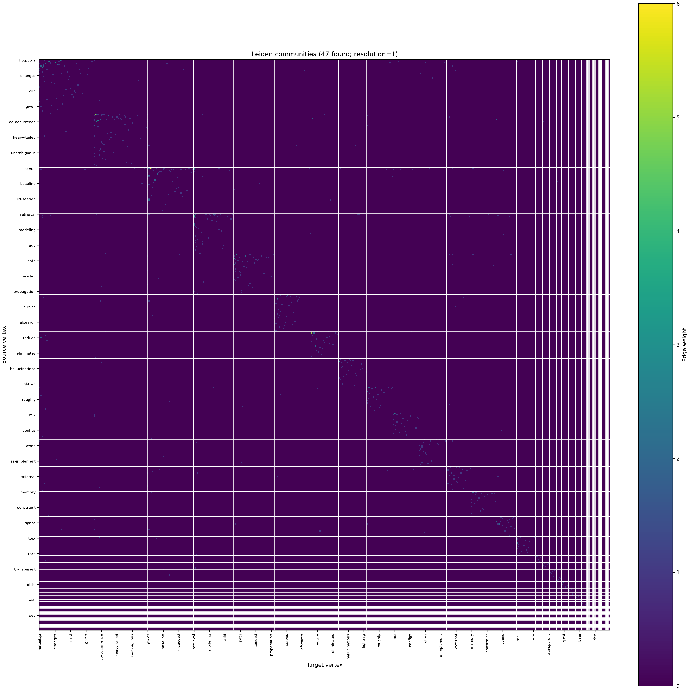

# block_diagonal_reorder.py

## 功能

使用 Leiden 或 Louvain 检测社区，并按社区顺序重排邻接矩阵。

## 输入与输出

输入为带标签的非负方阵 CSV；输出重排后的矩阵、社区顺序表及热力图。

## 输出示例

下图使用 `2.md` 生成的完整 481 节点有向共现矩阵，并采用 Leiden 方法重排；图中保留全部节点，仅调整排列顺序。



## 参数

以下为脚本当前提供的完整命令行参数和默认值。

```text
usage: block_diagonal_reorder.py [-h] [--method {leiden,louvain}]
                                 [--resolution RESOLUTION] [--seed SEED]
                                 [--iterations ITERATIONS] [--outdir OUTDIR]
                                 [--prefix PREFIX]
                                 [input]

Detect graph communities and reorder a labeled adjacency matrix.

positional arguments:
  input                 Labeled adjacency-matrix CSV

options:
  -h, --help            show this help message and exit
  --method {leiden,louvain}
                        Community detection algorithm (default: leiden)
  --resolution RESOLUTION
                        Community granularity; higher values usually yield
                        smaller communities (default: 1)
  --seed SEED           Random seed (default: 42)
  --iterations ITERATIONS
                        Leiden iterations; -1 runs until stable (default: -1;
                        ignored by Louvain)
  --outdir OUTDIR       Output directory (default: output/block_diagonal)
  --prefix PREFIX       Output filename prefix (default: input filename)
```

参数变更以脚本的 `--help` 输出为准。
