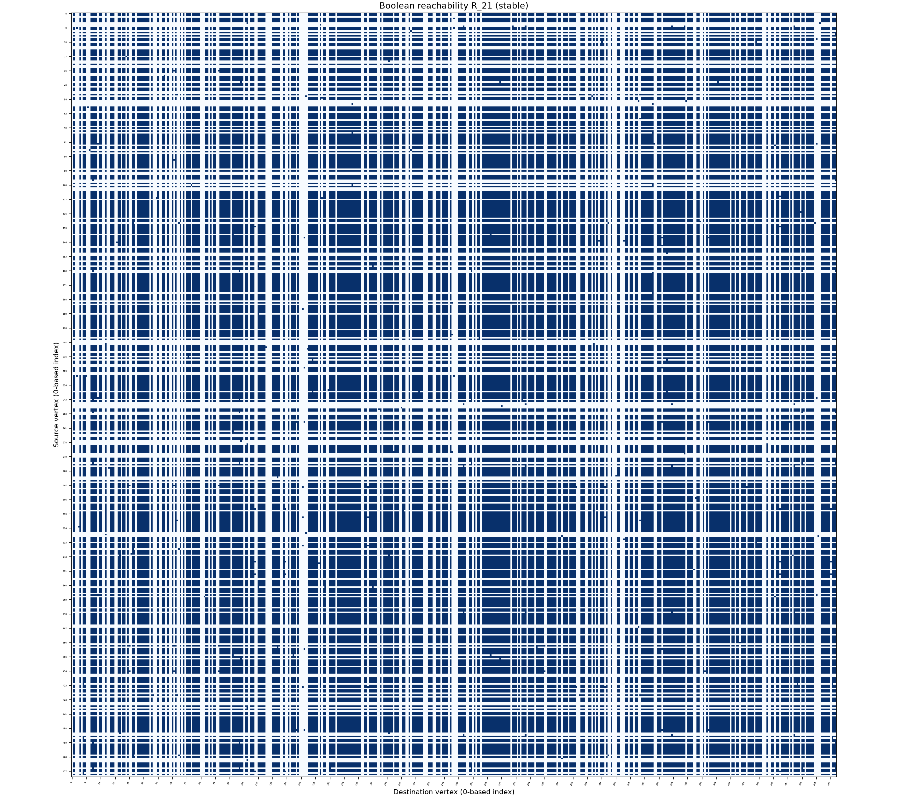
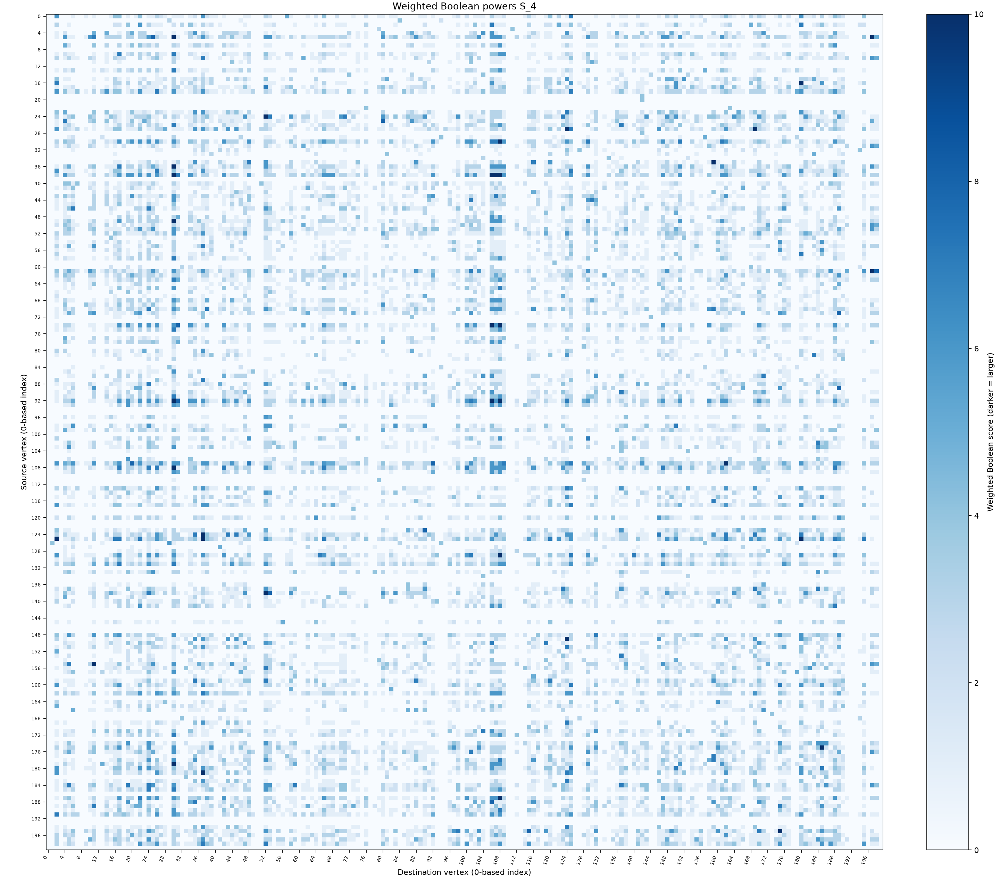
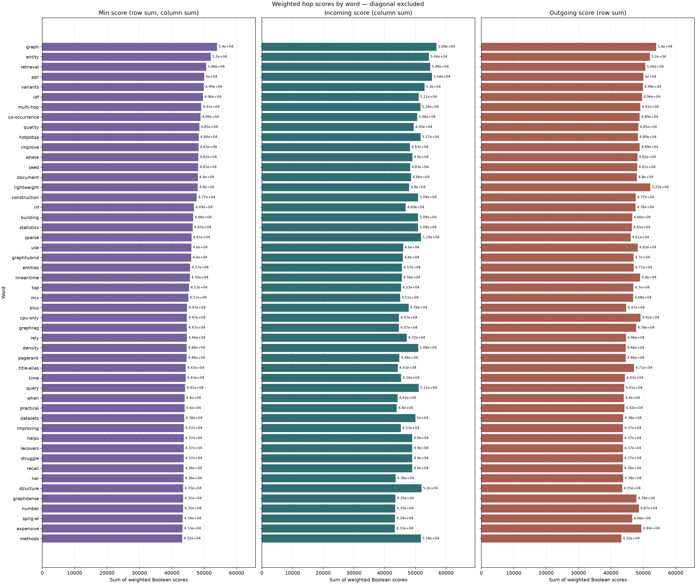

# bool_hop_stability.py

## 功能

逐步计算 Boolean n-hop 累计可达关系，判断其稳定步数，并可生成加权 hop 矩阵。

## 原理

将输入转成 Boolean 邻接矩阵 `B`，只保留边是否存在。精确 hop 矩阵 `B^k` 表示节点对之间是否存在恰好 `k` 条边的路径，矩阵乘法采用 Boolean 运算（AND/OR），不统计路径条数。累计可达矩阵为：

```text
R_1 = B
R_k = R_(k-1) OR B^k
```

当 `R_(k+1) = R_k` 时，后续 hop 不会增加新的可达节点对，程序将 `k` 判为稳定 hop。边方向按输入保留；有向环的对角线可在后续 hop 中变为可达。这里的“路径”允许重复经过节点和边，即图论中的游走（walk）。累计可达关系稳定不代表加权矩阵已数值收敛；程序只计算到该稳定 hop，指数模式同样在此截断。

逐步输出的加权矩阵有两种定义：

- `--decay linear`：`S_n = sum_(k=1..n) (n-k+1) B^k`。这里先对各精确 hop 的 Boolean 矩阵做普通数值求和，再累加这些部分和，因此较短 hop 会被重复计权；同一节点对在多个 hop 可达时会多次贡献。它与对 OR 累计矩阵 `R_k` 求和不同。
- `--decay exponential --alpha a`：`S_n = sum_(k=1..n) a^k B^k`，其中 `0 < a < 1`。hop 系数按几何级数衰减。

几何权重满足：

```text
a^n > a^(n+1) + a^(n+2) + ...    当且仅当 0 < a < 1/2
```

因为右侧等于 `a^(n+1)/(1-a)`。若要让第 `n` 阶的系数大于所有更长 hop 系数之和，应选择 `alpha < 0.5`。当前程序只校验 `0 < alpha < 1`，不会自动强制这个更严格的条件。该不等式比较的是几何权重；跨多个节点汇总后的总分还会受可达节点数量影响。

## 输入与输出

输入为带标签的有向或无向邻接矩阵 CSV；输出逐步可达矩阵、热力图及汇总统计。

## 输出示例

使用 `2.md` 生成的完整 481 节点 Boolean 邻接矩阵；累计可达关系在第 21 hop 稳定。矩阵图保持全量，逐词统计按 `min(incoming, outgoing)` 排序，只展示前 50 个词，并在一张图中显示。

### 第 21 阶累计可达矩阵



### 第 21 阶加权矩阵



### 逐词统计 Top 50



## 参数

以下为脚本当前提供的完整命令行参数和默认值。

```text
usage: bool_hop_stability.py [-h] [--outdir OUTDIR] [--cell-size CELL_SIZE]
                             [--top TOP] [--sort-by {incoming,outgoing,min}]
                             [--include-diagonal]
                             [--decay {linear,exponential}] [--alpha ALPHA]
                             input

Find when directed or undirected Boolean n-hop reachability stabilizes.

positional arguments:
  input                 Labeled square adjacency-matrix CSV; row = source,
                        column = destination

options:
  -h, --help            show this help message and exit
  --outdir OUTDIR       Directory for per-hop matrices and heatmaps
  --cell-size CELL_SIZE
                        Approximate heatmap cell size in inches (default:
                        0.35)
  --top TOP             Words to plot at each hop; 0 plots all, 50 per image
                        (default: 30)
  --sort-by {incoming,outgoing,min}
                        Rank each hop by column sum, row sum or their minimum
                        (default: incoming)
  --include-diagonal    Include self-return values in word statistics; hop
                        matrices are unchanged
  --decay {linear,exponential}
                        Hop weighting mode (default: linear)
  --alpha ALPHA         Exponential attenuation factor; required with --decay
                        exponential (0 < alpha < 1)
```

参数变更以脚本的 `--help` 输出为准。
