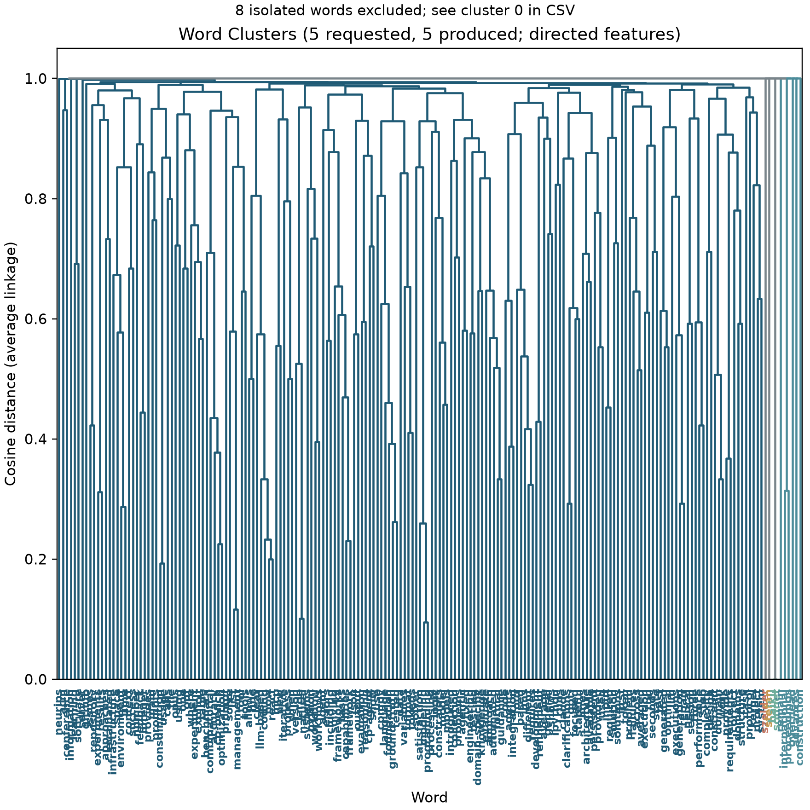

# cluster_words.py

## 功能

按词的邻接模式进行余弦距离层次聚类，输出簇标签和树状图。

## 输入与输出

输入为带标签的邻接矩阵 CSV；输出聚类 CSV 和树状图。

## 输出示例

下图使用 `1.md` 生成的有向共现矩阵进行层次聚类。



## 参数

以下为脚本当前提供的完整命令行参数和默认值。

```text
usage: cluster_words.py [-h] [--clusters CLUSTERS]
                        [--direction {auto,directed,undirected}]
                        [--outdir OUTDIR] [--prefix PREFIX]
                        [--figure-size FIGURE_SIZE] [--keep-diagonal]
                        [input]

Hierarchically cluster words by adjacency-pattern similarity.

positional arguments:
  input                 Adjacency matrix CSV (default:
                        output/undirected_diag_zero.csv)

options:
  -h, --help            show this help message and exit
  --clusters CLUSTERS   Number of clusters (default: 6)
  --direction {auto,directed,undirected}
                        Feature interpretation; auto detects matrix asymmetry
                        (default: auto)
  --outdir OUTDIR       Output directory (default: output)
  --prefix PREFIX       Output filename prefix (default: input filename)
  --figure-size FIGURE_SIZE
                        Figure width in inches (default: based on word count)
  --keep-diagonal       Include diagonal counts in clustering features
                        (default: ignore)
```

参数变更以脚本的 `--help` 输出为准。
