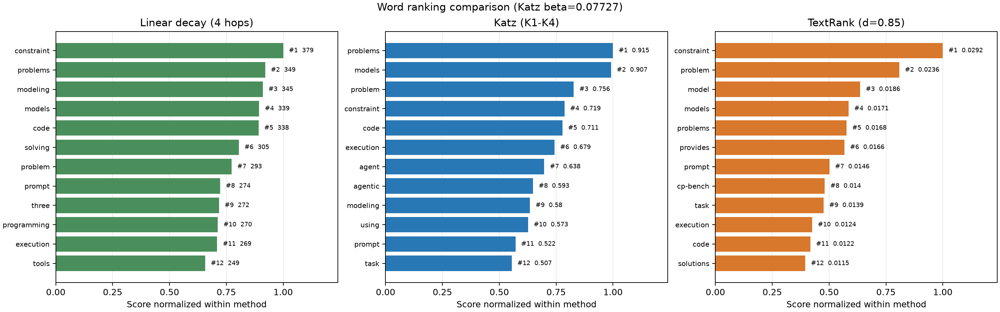

# compare_rankings.py

## 功能

比较 Boolean 多跳、截断 Katz 和 TextRank 三种方法的词语排名。

## 输入与输出

输入为零对角 Boolean 邻接矩阵 CSV；输出比较结果 CSV 和图像。

## 输出示例

下图使用 `1.md` 生成的 Boolean 邻接矩阵，对比多跳、Katz 和 TextRank 排名。



## 参数

以下为脚本当前提供的完整命令行参数和默认值。

```text
usage: compare_rankings.py [-h] [--outdir OUTDIR] [--top TOP] [--hop HOP]
                           [--beta BETA]
                           input

Compare linear n-hop, truncated Katz-4, and TextRank word rankings.

positional arguments:
  input            Labeled Boolean adjacency-matrix CSV with a zero diagonal

options:
  -h, --help       show this help message and exit
  --outdir OUTDIR
  --top TOP        Words shown per method; 0 plots all
  --hop HOP        Boolean linear-decay hop count (default: 4)
  --beta BETA      Katz attenuation; default is 0.85 / maximum row sum
```

参数变更以脚本的 `--help` 输出为准。
