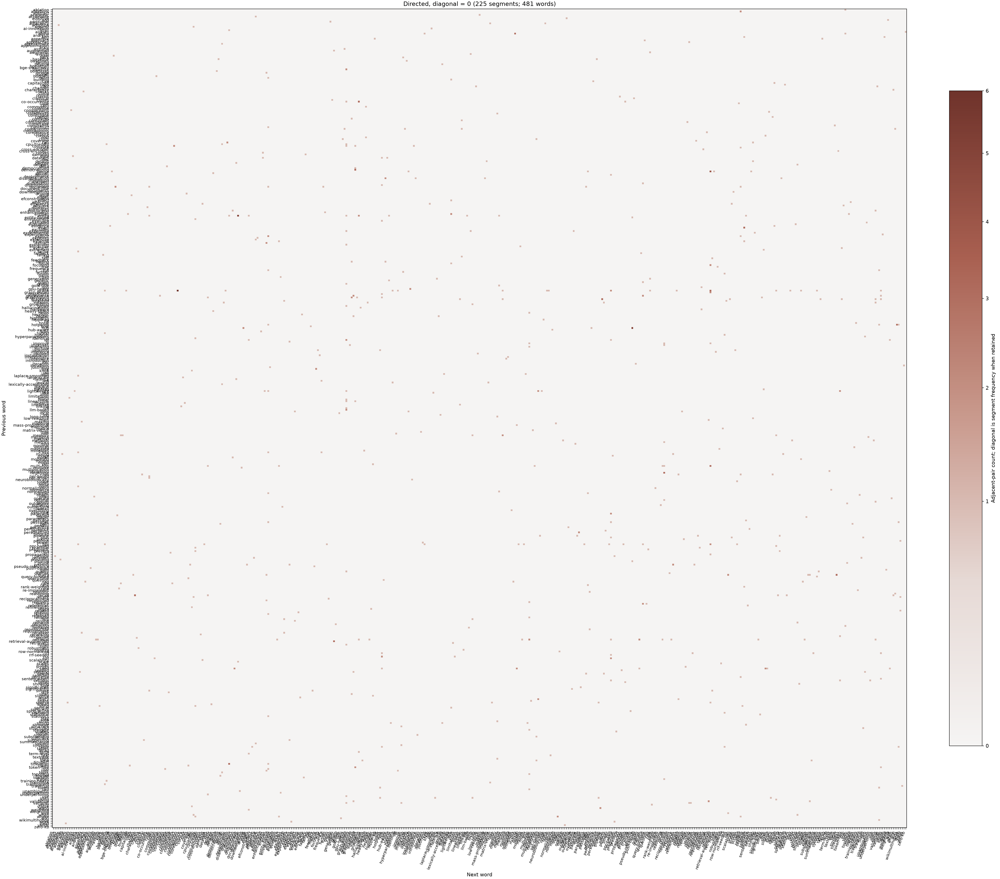

# cooccurrence.py

## 功能

清理英文 Markdown，统计相邻词，生成六种有向、无向及 Boolean 矩阵与热力图。

## 输入与输出

输入为英文 Markdown；输出六份矩阵 CSV 和对应热力图。

## 输出示例

下图使用 `2.md` 生成，显示基础共现矩阵全部 481 个词项；词项仍遵循脚本的分词、停用词、最小词长和频次规则。复现时使用 `--min-frequency 1 --plot-top-words 0`。



## 参数

以下为脚本当前提供的完整命令行参数和默认值。

```text
usage: cooccurrence.py [-h] [--outdir OUTDIR]
                       [--plot-top-words PLOT_TOP_WORDS]
                       [--min-frequency MIN_FREQUENCY]
                       [--min-length MIN_LENGTH] [--figure-size FIGURE_SIZE]
                       [input]

Generate six directed/undirected adjacent-word matrices and heatmaps.

positional arguments:
  input                 Input Markdown file (default: 1.md)

options:
  -h, --help            show this help message and exit
  --outdir OUTDIR       Output directory (default: output)
  --plot-top-words PLOT_TOP_WORDS
                        Most frequent N words to plot; use 0 for all (default:
                        40)
  --min-frequency MIN_FREQUENCY
                        Minimum number of segments containing a word (default:
                        2)
  --min-length MIN_LENGTH
                        Minimum token length (default: 3)
  --figure-size FIGURE_SIZE
                        Figure width in inches for all six heatmaps
```

参数变更以脚本的 `--help` 输出为准。
