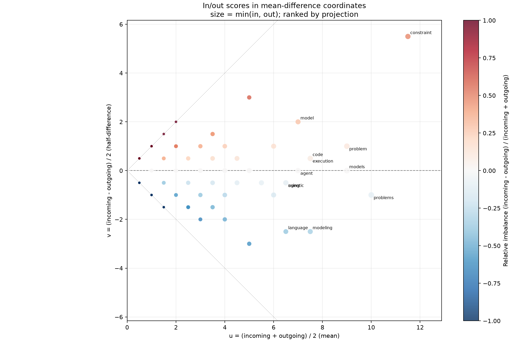

# inout_uv_scatter.py

## 功能

将节点入度和出度分数转换为总体量 u 与方向差 v 并绘图。

## 输入与输出

输入为加权方阵 CSV；输出逐词统计 CSV 和散点图。

## 输出示例

下图使用 `1.md` 的加权 hop 矩阵，将入/出分数投影到 `u-v` 坐标。



## 参数

以下为脚本当前提供的完整命令行参数和默认值。

```text
usage: inout_uv_scatter.py [-h] [--outdir OUTDIR] [--top TOP]
                           [--page-size PAGE_SIZE]
                           [--sort-by {projection,min,max}]
                           [--include-diagonal]
                           input

Plot in/out scores in mean-difference (u, v) coordinates.

positional arguments:
  input                 Weighted square matrix CSV; rows are sources and
                        columns are destinations

options:
  -h, --help            show this help message and exit
  --outdir OUTDIR       Output directory
  --top TOP             Primary ranked words to label; 0 labels all (default:
                        30)
  --page-size PAGE_SIZE
                        Labels per image; all points remain in every plot
                        (default: 0)
  --sort-by {projection,min,max}
                        Rank by diagonal projection u, min(in, out), or
                        max(in, out)
  --include-diagonal    Include self-return values in incoming and outgoing
                        scores
```

参数变更以脚本的 `--help` 输出为准。
