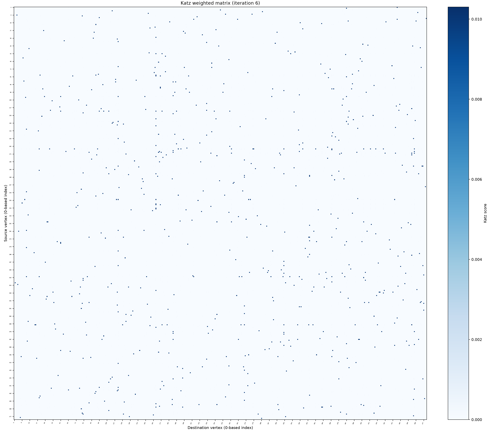

# katz_stability.py

## 功能

迭代累加邻接矩阵幂计算 Katz 分数，并记录迭代收敛过程。

## 原理

令 `A` 为输入的非负加权邻接矩阵，行表示出发节点、列表示到达节点。`A^k[i,j]` 汇总节点 `i` 到 `j` 的所有长度为 `k` 的游走（允许重复经过节点和边）的边权乘积之和。程序逐阶计算：

```text
T_k = beta^k A^k
K_n = sum_(k=1..n) T_k
```

当级数收敛时，利用 Neumann 级数可写成原始的逆矩阵闭式：

```text
K = (I - beta A)^(-1) - I
```

这里 `I` 是单位矩阵。若将 Katz 中心性表示为节点分数向量，则 `K * 1` 给出各节点的出发总分，`K.T * 1` 给出抵达总分；当前脚本输出完整的 `K` 矩阵，并据其行和、列和统计这两类分数。代码采用逐阶迭代近似该逆矩阵结果，而不是直接求逆。

当 `0 < beta < 1` 时，长度系数 `beta^k` 随阶数衰减；各阶实际贡献还受边权、游走数量影响，不能仅凭系数比较大小。与 `bool_hop_stability.py` 不同，Katz 使用原始边权和普通数值矩阵乘法，会累加多条路径的贡献，而非只判断某个 hop 是否可达。

无穷级数收敛条件是 `beta * rho(A) < 1`，其中 `rho(A)` 为邻接矩阵的谱半径。程序用幂迭代估计谱半径，并在运行前检查该条件；`beta` 必须非负且严格小于 `1 / rho(A)`（谱半径为 0 时不存在此上界）。每步比较新增项 `T_k` 的最大绝对值与累计矩阵 `K_k` 的最大绝对值，并按绝对/相对容差判断收敛；达到最大迭代数仍未收敛会报错。

逐词统计使用累计 Katz 矩阵的列和作为 incoming 分数、行和作为 outgoing 分数。默认排除对角线；`--include-diagonal` 可将自返路径纳入统计。

## 输入与输出

输入为带标签的非负加权方阵 CSV；输出加权矩阵、热力图和逐词统计。

## 输出示例

下图使用 `2.md` 生成的完整 481 节点有向共现矩阵，以 `beta=0.01` 迭代至第 6 阶收敛；矩阵热力图包含全部节点。



## 参数

以下为脚本当前提供的完整命令行参数和默认值。

```text
usage: katz_stability.py [-h] [--outdir OUTDIR] --beta BETA
                         [--max-iterations MAX_ITERATIONS] [--atol ATOL]
                         [--rtol RTOL] [--cell-size CELL_SIZE] [--top TOP]
                         [--sort-by {incoming,outgoing,min}]
                         [--include-diagonal]
                         input

Compute Katz scores by iterative path summation.

positional arguments:
  input                 Labeled square adjacency-matrix CSV; row = source,
                        column = destination

options:
  -h, --help            show this help message and exit
  --outdir OUTDIR       Directory for weighted matrices, heatmaps and word
                        statistics
  --beta BETA           Attenuation factor; choose beta below the reciprocal
                        spectral radius
  --max-iterations MAX_ITERATIONS
  --atol ATOL
  --rtol RTOL
  --cell-size CELL_SIZE
  --top TOP             Words per statistics plot; 0 means all
  --sort-by {incoming,outgoing,min}
  --include-diagonal
```

参数变更以脚本的 `--help` 输出为准。
