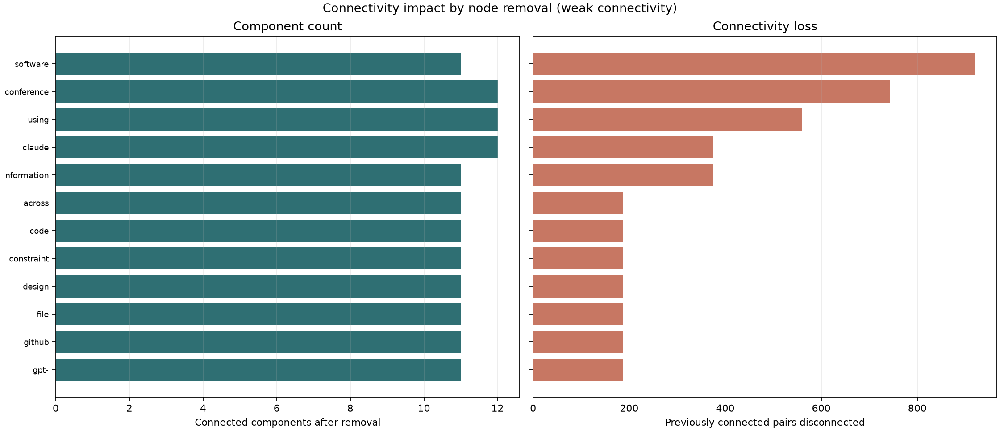

# node_removal_connectivity.py

## 功能

逐个模拟移除节点，比较移除前后的连通分量和可达关系变化。

## 输入与输出

输入为带标签的有向或无向邻接矩阵 CSV；输出节点影响统计 CSV 和图像。

## 输出示例

下图使用 `1.md` 生成的 Boolean 矩阵，按弱连通性统计移除节点的影响。



## 参数

以下为脚本当前提供的完整命令行参数和默认值。

```text
usage: node_removal_connectivity.py [-h] [--outdir OUTDIR] [--top TOP]
                                    [--mode {weak,strong}]
                                    input

Measure and plot connectivity changes caused by removing each vertex.

positional arguments:
  input                 Labeled square adjacency-matrix CSV

options:
  -h, --help            show this help message and exit
  --outdir OUTDIR       Output directory
  --top TOP             Nodes shown in the plot; 0 shows all (default: 30)
  --mode {weak,strong}  Connectivity for directed graphs (default: weak)
```

参数变更以脚本的 `--help` 输出为准。
