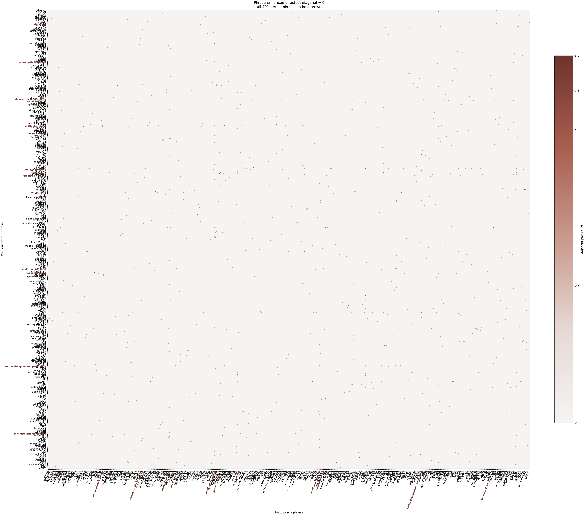

# phrase_enhance.py

## 功能

从 Markdown 中筛选连续相邻二词组合，合并原文匹配并重建矩阵。

## 输入与输出

输入为英文 Markdown；输出候选报告、增强后的六种矩阵及热力图（可关闭绘图）。

## 输出示例

下图使用 `2.md` 生成，展示词组合并后通过候选频次、NPMI 和片段频次筛选的全部 491 个词项；热力图没有再按 Top-N 截断。复现时使用 `--top-words 0 --plot-top-words 0`。



## 参数

以下为脚本当前提供的完整命令行参数和默认值。

```text
usage: phrase_enhance.py [-h] [--outdir OUTDIR]
                         [--min-phrase-frequency MIN_PHRASE_FREQUENCY]
                         [--min-npmi MIN_NPMI] [--min-frequency MIN_FREQUENCY]
                         [--top-words TOP_WORDS] [--min-length MIN_LENGTH]
                         [--plot-top-words PLOT_TOP_WORDS]
                         [--figure-size FIGURE_SIZE] [--no-plots]
                         [input]

Mine adjacent bigram phrases from Markdown and rebuild six count/Boolean
matrices.

positional arguments:
  input                 Input Markdown file (default: 1.md)

options:
  -h, --help            show this help message and exit
  --outdir OUTDIR       Output directory (default: output/phrase)
  --min-phrase-frequency MIN_PHRASE_FREQUENCY
                        Minimum raw adjacent-pair count (default: 3)
  --min-npmi MIN_NPMI   Minimum pair NPMI in [-1, 1] (default: 0.2)
  --min-frequency MIN_FREQUENCY
                        Minimum segment frequency after merging (default: 2)
  --top-words TOP_WORDS
                        Keep top N terms after merging; 0 keeps all (default:
                        40)
  --min-length MIN_LENGTH
                        Minimum component/word length (default: 3)
  --plot-top-words PLOT_TOP_WORDS
                        Plot top N terms by merged segment frequency; 0 plots
                        all (default: 40)
  --figure-size FIGURE_SIZE
                        Heatmap width in inches (default: based on displayed
                        term count)
  --no-plots            Write CSV outputs only
```

参数变更以脚本的 `--help` 输出为准。
