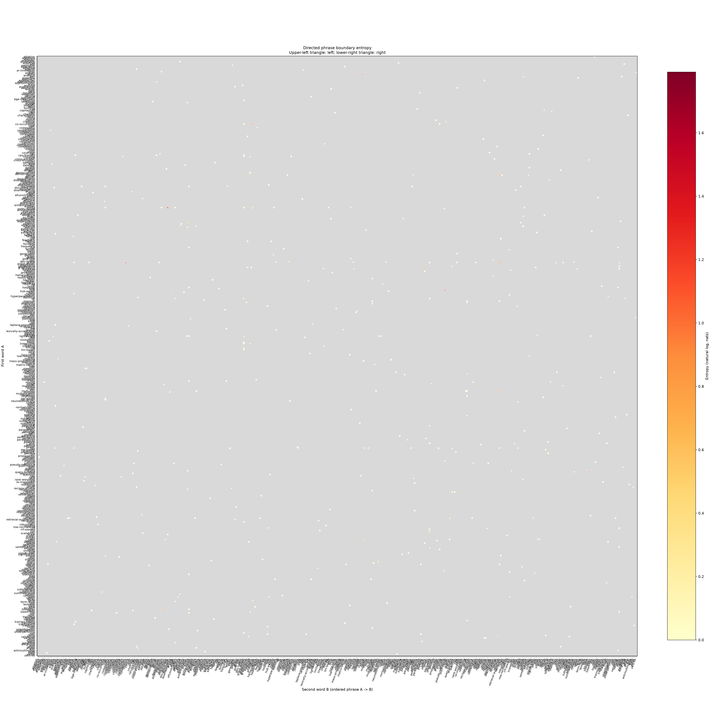

# phrase_entropy.py

## 功能

计算有向连续二词组的左、右和联合边界熵，输出矩阵、报告和图像。

## 输入与输出

输入为英文 Markdown，可选候选 CSV；输出熵矩阵 CSV、边界报告和热力图。

## 输出示例

下图使用 `2.md`，展示有向二词组全部 481 个源词项的左右边界熵。未按短语频次或 Top-N 裁剪词轴；复现时使用 `--min-phrase-frequency 0 --plot-top-words 0`。



## 参数

以下为脚本当前提供的完整命令行参数和默认值。

```text
usage: phrase_entropy.py [-h] [--outdir OUTDIR] [--prefix PREFIX]
                         [--phrase-candidates PHRASE_CANDIDATES]
                         [--min-phrase-frequency MIN_PHRASE_FREQUENCY]
                         [--min-length MIN_LENGTH]
                         [--plot-top-words PLOT_TOP_WORDS]
                         [--figure-size FIGURE_SIZE]
                         [input]

Read Markdown and plot exact left, right, and joint phrase entropy for
directed bigrams only.

positional arguments:
  input                 Source Markdown (default: 1.md)

options:
  -h, --help            show this help message and exit
  --outdir OUTDIR       Output directory
  --prefix PREFIX       Output filename prefix (default: input filename stem)
  --phrase-candidates PHRASE_CANDIDATES
                        Optional phrase_candidates.csv; analyze all listed
                        ordered pairs
  --min-phrase-frequency MIN_PHRASE_FREQUENCY
                        Minimum phrase count after paragraph deduplication; 0
                        keeps all phrases and source word axes; positive
                        values also prune words absent from retained phrases
                        (default: 0)
  --min-length MIN_LENGTH
                        Minimum phrase token length (default: 3)
  --plot-top-words PLOT_TOP_WORDS
                        Optional display limit by phrase counts; 0 keeps the
                        full source vocabulary (default: 0)
  --figure-size FIGURE_SIZE
                        Figure width in inches
```

参数变更以脚本的 `--help` 输出为准。
