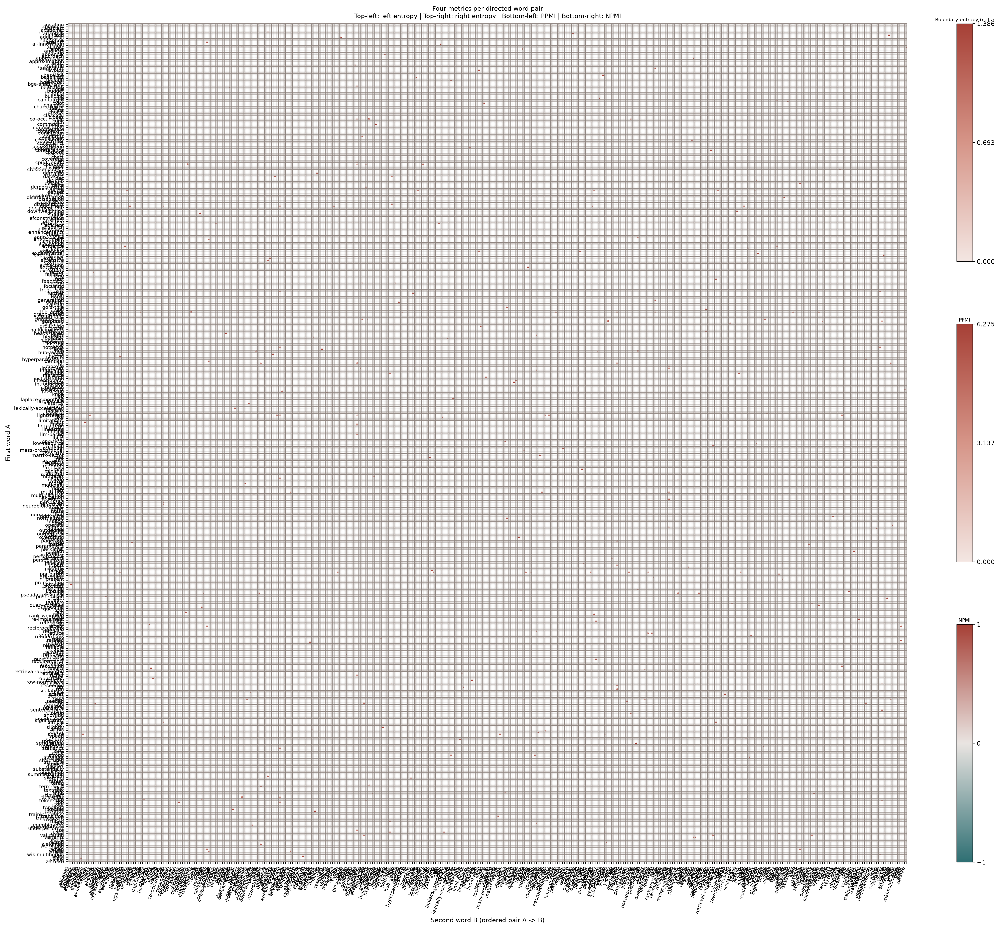

# phrase_metrics.py

## 功能

在统一词轴上计算有向二词组边界熵、PPMI 和 NPMI。

## 输入与输出

输入为英文 Markdown，可选候选 CSV；输出指标矩阵、报告和综合图像。

## 输出示例

下图使用 `2.md`，在完整 481 词词轴上展示左熵、右熵、PPMI 和 NPMI 四项指标；复现时使用 `--plot-top-words 0`，且不设置绘图频次过滤。



## 参数

以下为脚本当前提供的完整命令行参数和默认值。

```text
usage: phrase_metrics.py [-h] [--outdir OUTDIR] [--prefix PREFIX]
                         [--phrase-candidates PHRASE_CANDIDATES]
                         [--plot-min-phrase-frequency PLOT_MIN_PHRASE_FREQUENCY]
                         [--min-length MIN_LENGTH]
                         [--plot-top-words PLOT_TOP_WORDS]
                         [--figure-size FIGURE_SIZE]
                         [input]

Compute and plot left/right entropy, PPMI, and NPMI in one heatmap.

positional arguments:
  input                 Source Markdown (default: 1.md)

options:
  -h, --help            show this help message and exit
  --outdir OUTDIR       Output directory
  --prefix PREFIX       Output filename prefix (default: input filename stem)
  --phrase-candidates PHRASE_CANDIDATES
                        Optional candidate CSV with left and right columns
  --plot-min-phrase-frequency PLOT_MIN_PHRASE_FREQUENCY
                        Filter plotted pairs and axes by phrase count; CSV
                        data is unchanged
  --min-length MIN_LENGTH
                        Minimum token length for phrase words (default: 3)
  --plot-top-words PLOT_TOP_WORDS
                        Displayed axes by pair strength; 0 displays all
                        (default: 0)
  --figure-size FIGURE_SIZE
                        Figure width and height in inches (default: based on
                        word count)
```

参数变更以脚本的 `--help` 输出为准。
