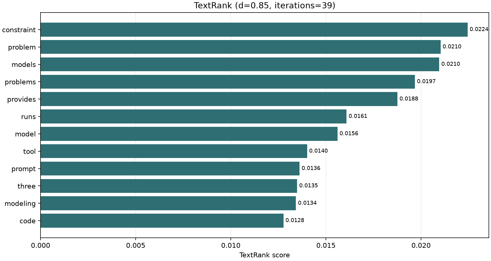

# textrank.py

## 功能

在带权有向或无向邻接矩阵上计算 TextRank 词语分数。

## 输入与输出

输入为带标签的加权邻接矩阵 CSV；输出全词分数 CSV 和排名图。

## 输出示例

下图使用 `1.md` 生成的有向共现矩阵计算 TextRank。



## 参数

以下为脚本当前提供的完整命令行参数和默认值。

```text
usage: textrank.py [-h] [--outdir OUTDIR] [--top TOP] [--damping DAMPING]
                   [--tolerance TOLERANCE] [--max-iterations MAX_ITERATIONS]
                   input

Rank words in a labeled weighted adjacency matrix with TextRank.

positional arguments:
  input                 Labeled weighted adjacency-matrix CSV; row = source,
                        column = destination

options:
  -h, --help            show this help message and exit
  --outdir OUTDIR       Output directory
  --top TOP             Words to plot; 0 plots all
  --damping DAMPING     Damping factor (default: 0.85)
  --tolerance TOLERANCE
                        L1 convergence tolerance
  --max-iterations MAX_ITERATIONS
                        Iteration limit
```

参数变更以脚本的 `--help` 输出为准。
