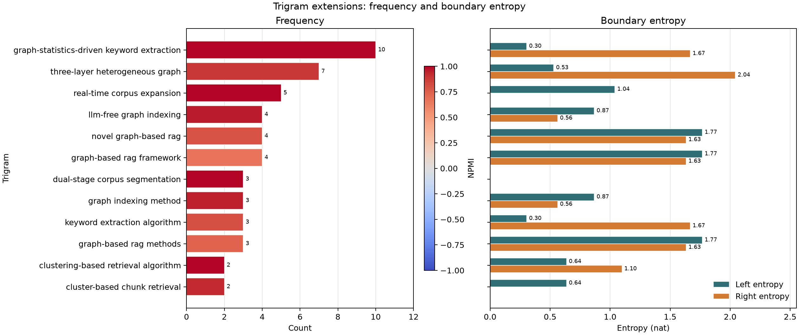

# trigram_potential.py

## 功能

分析指定二词候选在原文中的左右三词扩展及其频次、边界熵。

## 输入与输出

输入为英文 Markdown 和必需的二词候选 CSV；输出扩展统计 CSV 和图表。

## 输出示例

下图使用 `3.md` 及其候选二词表，展示候选词组的三词扩展潜力。



## 参数

以下为脚本当前提供的完整命令行参数和默认值。

```text
usage: trigram_potential.py [-h] --phrase-candidates PHRASE_CANDIDATES
                            [--outdir OUTDIR] [--prefix PREFIX]
                            [--min-trigram-count MIN_TRIGRAM_COUNT]
                            [--min-length MIN_LENGTH] [--top TOP]
                            [input]

Score and visualize observed three-word extensions of selected bigrams.

positional arguments:
  input                 Source Markdown (default: 1.md)

options:
  -h, --help            show this help message and exit
  --phrase-candidates PHRASE_CANDIDATES
                        Candidate CSV with left and right columns, e.g.
                        select_bigrams output
  --outdir OUTDIR       Output directory
  --prefix PREFIX       Output filename prefix (default: input filename stem)
  --min-trigram-count MIN_TRIGRAM_COUNT
                        Minimum triple occurrences (default: 2)
  --min-length MIN_LENGTH
                        Minimum token length; stopwords are excluded (default:
                        3)
  --top TOP             Maximum plotted candidates by trigram frequency; 0
                        plots all (default: 30)
```

参数变更以脚本的 `--help` 输出为准。
