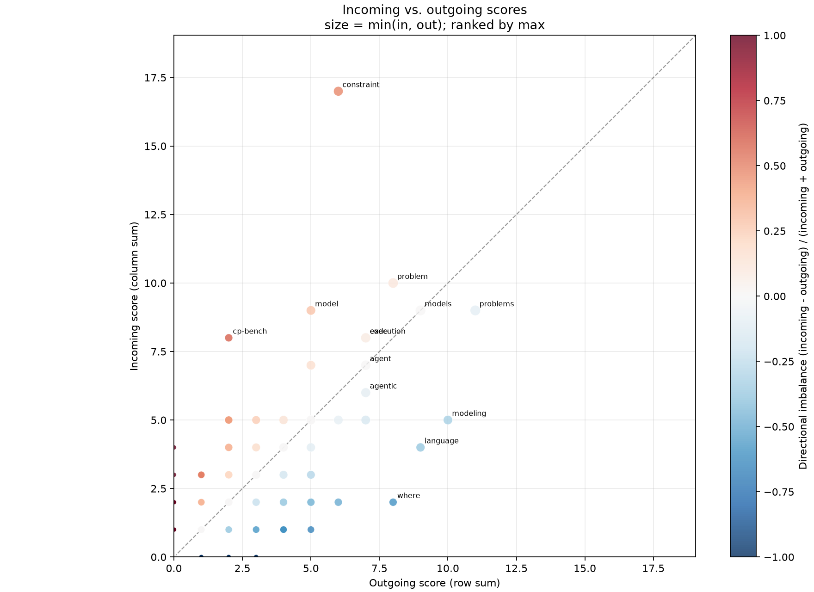

# weighted_inout_scatter.py

## 功能

直接从加权矩阵计算入边/出边总分并绘制对照散点图。

## 输入与输出

输入为加权方阵 CSV；输出逐词统计 CSV 和散点图。

## 输出示例

下图使用 `1.md` 生成的加权 hop 矩阵，展示节点入边与出边分数。



## 参数

以下为脚本当前提供的完整命令行参数和默认值。

```text
usage: weighted_inout_scatter.py [-h] [--outdir OUTDIR] [--top TOP]
                                 [--page-size PAGE_SIZE]
                                 [--sort-by {max,min,total}]
                                 [--include-diagonal]
                                 input

Plot incoming and outgoing scores directly from a weighted matrix CSV.

positional arguments:
  input                 Weighted square matrix CSV; rows are sources and
                        columns are destinations

options:
  -h, --help            show this help message and exit
  --outdir OUTDIR       Output directory
  --top TOP             Primary ranked words to label; 0 labels all (default:
                        30)
  --page-size PAGE_SIZE
                        Labels per image; all points remain in every plot
                        (default: 0)
  --sort-by {max,min,total}
                        Rank by max(incoming, outgoing), min(incoming,
                        outgoing), or their sum
  --include-diagonal    Include self-return values in incoming and outgoing
                        scores
```

参数变更以脚本的 `--help` 输出为准。
