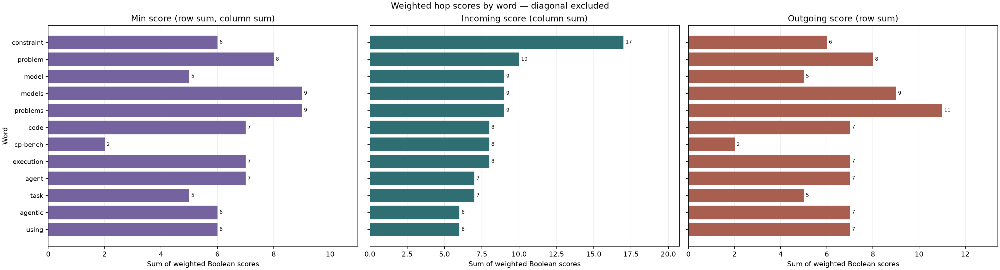

# weighted_word_stats.py

## 功能

按词汇总加权 hop 矩阵的入边、出边分数和可达节点数。

## 输入与输出

输入为加权 hop 矩阵 CSV；输出完整统计 CSV 和一个或多个柱状图。

## 输出示例

下图使用 `1.md` 生成的加权 hop 矩阵，按 incoming 分数展示词语统计。



## 参数

以下为脚本当前提供的完整命令行参数和默认值。

```text
usage: weighted_word_stats.py [-h] [--outdir OUTDIR] [--top TOP]
                              [--sort-by {incoming,outgoing,min}]
                              [--include-diagonal]
                              [input]

Summarize weighted hop matrices by word without loading the whole matrix.

positional arguments:
  input                 Weighted hop matrix CSV (default:
                        output/bool_hop_stability/weighted_012.csv)

options:
  -h, --help            show this help message and exit
  --outdir OUTDIR       Output directory
  --top TOP             Words to plot; 0 plots all, at most 40 per image
                        (default: 30)
  --sort-by {incoming,outgoing,min}
                        Rank by column sum, row sum or their minimum (default:
                        incoming)
  --include-diagonal    Include self-return scores in sums and reachable
                        counts
```

参数变更以脚本的 `--help` 输出为准。
